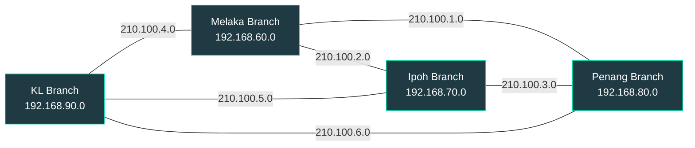

<div align="center">


<a href="https://git.io/typing-svg">
  
</a>


</div>

---

## 📖 About This Project

A group assignment for **Introduction to Networking** at Asia Pacific University (2023). The team designed and configured the network for **MapleTech**, a fictional company with four branches in Malaysia: **Kuala Lumpur (KL), Ipoh, Melaka and Penang**.

Each branch has its own LAN, and the four branches are joined by a WAN so staff can share resources and communicate securely across the whole organisation. The project covers everything from floor plans and addressing through to device configuration and working network services.

**What the report delivers**

- A floor plan for every branch, drawn in Visual Paradigm
- A logical topology per branch in Cisco Packet Tracer, with justification
- A subnet and IP addressing scheme per branch, with justification
- Switch and router configuration, including device security
- Central DHCP and DNS, plus email, web and IoT servers
- WAN routing between all four branches using RIP

---

## 🔍 Who Uses This Kind of Design and Why

| Audience | How they use it | Why it matters |
|---|---|---|
| **Network engineers** | Plan subnets, choose topologies and configure routing for multi-site companies | A clear addressing plan and a redundant WAN avoid renumbering and outages later |
| **IT support and helpdesk** | Rely on DHCP, DNS and well-named devices to find and fix problems quickly | Central services and consistent naming make troubleshooting faster |
| **IT managers** | Weigh cost, scalability and resilience when choosing star, extended star or mesh | The report documents the trade-offs behind each choice |
| **Security teams** | Review device hardening, segmentation and IoT exposure | Per-room subnets and secured switches limit what a compromise can reach |
| **Students and trainers** | Reuse the scenario to practise subnetting, DHCP relay and RIP in Packet Tracer | It is a complete, realistic end-to-end exercise |

---

## 🗺️ Network Overview



### Topologies used

| Level | Topology | Why |
|---|---|---|
| Inside each room | **Star** | Easy to manage, a failed device does not affect the others, simple to add devices |
| Larger rooms | **Extended star** | Extra switches hang off the main switch, so the network can grow and faults stay contained |
| Between branches (WAN) | **Full mesh** | Every branch router links to every other, so traffic survives a single link failure |

**Trade-offs the report notes:** a star depends on its central switch, extended stars add cabling cost and can congest the core switch, and a full mesh is more expensive to build and maintain.

---

## 🏢 Branches and Addressing

Every branch uses a private Class C range and is split into one subnet per room or department using variable-length subnet masks (VLSM). Using private addresses keeps internal traffic isolated from the public internet.

| Branch | Network | Subnets (largest to smallest) | Designer |
|---|---|---|---|
| **KL** | `192.168.90.0` | Finance `/25`, HR `/26`, Server room `/27`, CEO room `/28` | Mahmoud Samy Aly Ibrahim Shahin |
| **Penang** | `192.168.80.0` | Staff office `/26`, Reception `/27`, Manager `/27`, Server room `/28` | Mohamed Abdurrazag Jaber Seklani |
| **Ipoh** | `192.168.70.0` | Customer service `/26`, Sales `/27`, IT office `/28`, Server office `/28` | Shady Ehab Assad Ibrahim |
| **Melaka** | `192.168.60.0` | Office room `/26`, Break room `/27`, Server room `/28` | Mohammed Rasheed Yehia Al Haddad (leader) |

The full per-subnet tables (network address, gateway, usable range and broadcast) are in the report.

### WAN links

Routers are joined by serial point-to-point links, one per pair of branches:

| Link | Network |
|---|---|
| Melaka and Penang | `210.100.1.0` |
| Melaka and Ipoh | `210.100.2.0` |
| Ipoh and Penang | `210.100.3.0` |
| KL and Melaka | `210.100.4.0` |
| KL and Ipoh | `210.100.5.0` |
| KL and Penang | `210.100.6.0` |

---

## 🖥️ Services

| Service | Location | Purpose |
|---|---|---|
| **DHCP** | Melaka server room | One server hands out addresses for every branch, with a pool per room (gateway, DNS, start address and mask) |
| **DNS** | Melaka server room | Resolves company names so users do not need to remember IPs |
| **Web server** | Penang server room | Hosts the MapleTech website |
| **Email server** | Ipoh | SMTP and POP3 for the company mail domain, with a user account per team member |
| **IoT server** | KL | Central dashboard for cameras, smoke detectors, sensors and appliances |

**DHCP across branches:** routers use `ip helper-address` on the LAN-facing interface so DHCP requests from other branches are forwarded to the central server.

**IoT devices modelled:** webcams, smoke detectors, RFID reader on the server room, trip sensors, air conditioners, appliances, fans and doors.

---

## ⚙️ Configuration Highlights

Example patterns used on the switches and routers (values shown as placeholders):

```text
! Management IP on a switch
enable
configure terminal
interface vlan 1
 ip address <switch-ip> <mask>
 no shutdown
 description <room> switch
exit
ip default-gateway <gateway-ip>
end
copy running-config startup-config

! Hostname, banner and password protection
hostname <Branch>_switch
banner motd $ <room name> $
line console 0
 password <console-password>
 login
exit
service password-encryption
enable secret <privilege-password>

! DHCP relay on a router interface
interface <lan-interface>
 ip helper-address <dhcp-server-ip>
 no shutdown

! RIP routing
router rip
 network <connected-network>
```

> 🔒 The report lists the lab device passwords. They are deliberately left out of this README.

**Security measures applied:** device hostnames, login banners, console and privileged-mode passwords, and password encryption on every switch and router.

**Ideas for improvement:** use `enable secret` everywhere (not `enable password`), move management to SSH, add VLANs and access control lists between departments, run RIPv2 or OSPF, and add a second DHCP and DNS server for redundancy.

---

## 🧰 Tools and Technologies


---

## 👥 Team

| Member | Responsibility |
|---|---|
| Mohammed Rasheed Yehia Al Haddad (leader) | Melaka branch: floor plan, topology, addressing, switch and router configuration, DHCP, DNS |
| Mohamed Abdurrazag Jaber Seklani | Penang branch: floor plan, topology, addressing, configuration, web server |
| Shady Ehab Assad Ibrahim | Ipoh branch: floor plan, topology, addressing, configuration, email server |
| Mahmoud Samy Aly Ibrahim Shahin | KL branch: floor plan, topology, addressing, configuration, IoT server |

Each member also connected their branch router to the other branches.

---

## 📚 References

1. Techopedia (2023). *What is Star Topology?* <https://www.techopedia.com/definition/13335/star-topology>
2. Bhardwaj, R. (2021). *Extended star network topology.* Network Interview. <https://networkinterview.com/extended-star-network-topology/>
3. Keary, T. (2023). *6 best network topologies explained, pros and cons.* Comparitech. <https://www.comparitech.com/net-admin/network-topologies-advantages-disadvantages/>
4. Sunbird DCIM (2021). *Star Topology.* <https://www.sunbirddcim.com/glossary/star-topology>
5. EDUCBA (2020). *Extended Star Topology, Importance and Uses.* <https://www.educba.com/extended-star-topology/>
6. Prasanna (2023). *Star Topology Advantages and Disadvantages.* A Plus Topper. <https://www.aplustopper.com/star-topology-advantages-and-disadvantages/>
7. Mesh (2018). *What is Mesh Topology?* Computerhope. <https://www.computerhope.com/jargon/m/mesh.htm>

---

## 📫 Let's Connect

<div align="center">

**Shady** · Cyber Security student, Asia Pacific University

[](https://www.linkedin.com/in/shady-ehab-07666a255)
[](mailto:shadysoliman3322@gmail.com)


</div>
